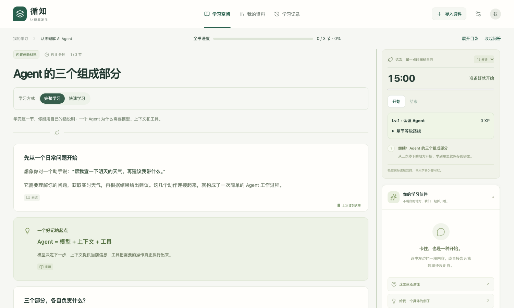
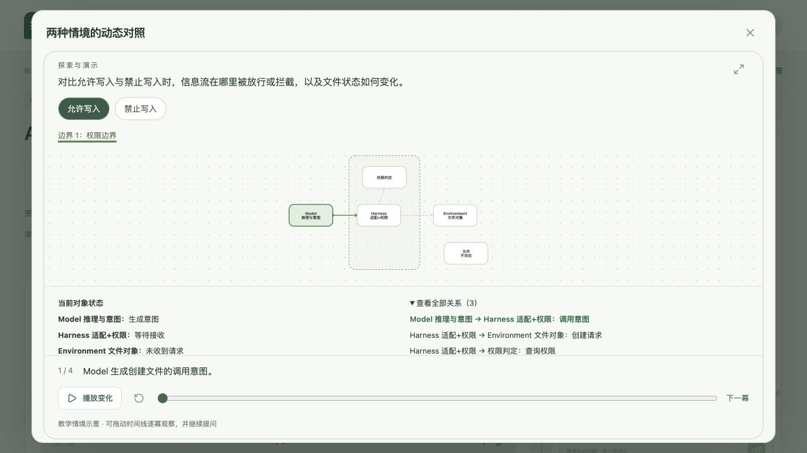
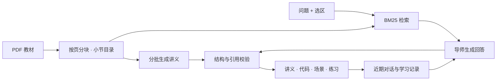

# 循知 · 可追溯的 PDF 学习 Agent

**把一本技术书变成可以逐段追问、逐行读代码、随时回到原页的互动课程。** 你决定学哪一节、学多深。循知负责从教材里找依据，选择讲解形式，并记住你上次读到哪里、哪道题还想再练一次。

[看一次交互演示](#一次工具调用可以怎么教) · [功能全览](#功能全览) · [本机启动](#本机启动) · [查看架构](#工程实现)



## 一次工具调用，可以怎么教？

读到 **Model、Harness 和 Environment** 时，一个容易卡住的问题是：“模型已经提出写文件的请求，为什么文件还没出现？”

下图是循知工作台中的权限演示。选「允许写入」，逐帧看模型提出意图、Harness 检查权限、环境中的文件发生变化；切到「禁止写入」，再看请求在哪一步被拦下。拖动时间线，可以停在同一阶段比较两个情境。



遇到代码时，同一个提问入口也能定位到行。例如，高亮消息列表里的 `"role": "system"` 后点「询问当前代码」，导师会收到**代码块标题、行号和高亮原文**。如果一句解释就够，导师可以直接回答；涉及边界、信息流或状态变化时，才需要演示区。

## 功能全览

| | 学习者可以做什么 |
| --- | --- |
| **教材与出处** | 导入文字版 PDF，按目录进入小节。没有目录时按页分组；文字提取不完整的页会被标记。打开讲义引用，可以从原文片段跳到 PDF 对应页。 |
| **学习路径** | 默认收起致谢和阅读指南，按需查看附属内容。也可以让模型依据原文重新判断哪些小节值得纳入学习路径，自己决定何时进入下一节。 |
| **快速版与完整版** | 快速版先读重点；完整版分批处理本节全部已提取片段，把原文和代码按页集中保留。两版准备好后可以直接切换，各自恢复书签。 |
| **选段追问与代码走读** | 框选一句话，带着选区继续问。代码块支持点选行号、上下步高亮和中间变量说明，方便追问“这一步为什么这样做”。 |
| **交互场景** | 根据内容呈现对象、边界、连线和状态；支持多情境对比、逐帧播放、拖动时间线与放大查看。 |
| **生成时复习** | 准备完整讲义时可以重做旧题、翻看解释、跳回出题段落，再回到同一张卡继续答。新课准备好后，由你点击进入。 |
| **可回看的学习记忆** | 找回原问题、引用选区、当时的回答、练习选择及提示使用情况。复习笔记单独保存；旧记录缺少精确位置时仍可回到对应小节。 |
| **进度与反馈** | 每日任务结合阅读位置和待复习记录安排。支持专注倒计时、每题首次答对获得经验、章节等级，以及按已确认理解的正文小节统计的全书进度。 |

**第一次体验**可以用内置课程「从零理解 AI Agent」。做完第一节的天气工具题，打开「学习记录」，回看自己的选择，再点「回到学习位置」。这条路径可以直接体验练习、记忆和原题定位，无需模型密钥。

## 本机启动

准备 **Python 3.12** 和 **Node.js 22.12 或更高版本**。以下命令适用于 macOS 和 Linux。

```sh
git clone https://github.com/Caijidada/xunzhi-learning-agent.git
cd xunzhi-learning-agent
python3.12 -m venv .venv
.venv/bin/python -m pip install -r server/requirements-lock.txt
npm --prefix web ci
.venv/bin/python scripts/dev.py
```

打开 [本地学习空间](http://127.0.0.1:5173/)。**首次体验可以跳过密钥配置**。内置示例提供预写的课程和回答，可以先试一次选段提问、查看出处和回到原题。

<details>
<summary><strong>接入 DeepSeek，使用自己的 PDF 生成讲义</strong></summary>

在项目根目录运行 `cp .env.example .env`，在本机填写 `LLM_API_KEY`，并根据账户可用模型设置 `LLM_MODEL`。重启服务后导入文字版 PDF，选择小节并点击「开始这一节」。

课程、学习记录和任务保存在本机 `data/`。生成讲义或回答时，后端会把相关原文和对话发送给配置的模型服务。密钥只在后端读取。

</details>

## 工程实现

模型负责解释教材、编排场景和提出练习；应用负责检索、校验、保存版本、判题和恢复任务。前端用 Vue 3 与 TypeScript 渲染，后端用 FastAPI 调度，SQLite 保存课程与学习状态。



| 关键设计 | 具体做法 |
| --- | --- |
| **检索与引用落到同一页** | 片段始终保留在单个物理页内。中文分词后的 BM25 检索结合当前章节加权，导师获得最多 6 个候选片段；输出中的引用 ID 必须来自本次材料。[材料与检索](server/app/materials.py) |
| **长任务按批恢复** | 完整讲义每批处理 4 个片段，成功后写入检查点。若第 4 批失败，前三批可复用。快速版与完整版按修订号归档，切换已有版本直接读取 SQLite。[讲义生成](server/app/lessons.py) · [版本存储](server/app/store.py) |
| **生成结果先校验再渲染** | Pydantic 检查内容结构、代码行范围、场景节点与连线引用。首次失败时把具体问题交给模型修正一次，再次失败则向用户报告原因。任务记录调用次数、耗时及 token 用量。[输出校验](server/app/provider.py) · [场景定义](server/app/scenes.py) |
| **学习记忆保留当时的证据** | 问答关联选区与讲义版本，练习由服务端判题。复习状态和笔记独立保存，同一道题重复作答只发放一次经验；后续辅导可以带上近期记录。[学习服务](server/app/service.py) · [接口实现](server/app/main.py) |

**可复现验证。** 后端回归测试覆盖停止后续做、分批失败恢复、版本切换与书签、越界代码行、无效场景引用、经验去重和复习记录回溯。前端构建同时执行 TypeScript 检查。下方命令可在本机复现。[查看测试用例](server/tests/test_workflow.py)

**当前范围**为个人本机学习。代码走读展示模型标注的步骤；代码沙箱、扫描件 OCR 和从选题开始的联网研究仍待实现。引用校验能确认出处存在，讲解与原文是否一致仍需核对。

<details>
<summary><strong>运行检查与单服务启动</strong></summary>

```sh
.venv/bin/python -m pytest server/tests -q
npm --prefix web run build
.venv/bin/python -m uvicorn server.app.main:app --host 127.0.0.1 --port 8000
```

构建后可通过 [本地单服务入口](http://127.0.0.1:8000/) 使用工作台。后端测试使用临时数据库和模拟模型响应。备份本机学习数据时，先停止服务，再复制整个 `data/` 目录。

</details>

[开发进度](docs/开发进度.md) · [教学策略验收](docs/教学策略验收.md) · [开源借鉴记录](THIRD_PARTY_NOTICES.md)
