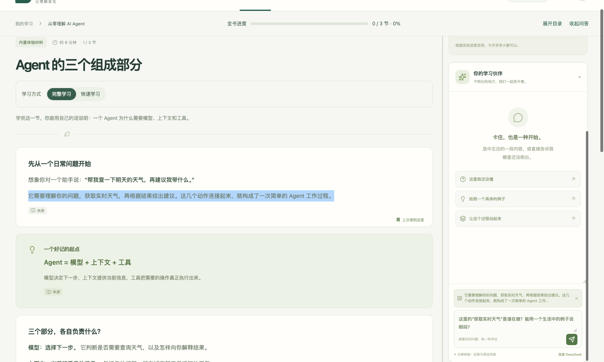

# 循知 · 边读边问的 PDF 学习工作台

把一本技术书交给循知，选一节开始学。**读到不懂的地方，用鼠标选中那句话，直接在右侧问 AI。** 讲义、问题和原文出处都在同一个工作台里。今天学到哪里、当时卡在哪一行、后来有没有弄懂，下次打开还可以接着看。

[怎样使用](#从导入一本书到回顾一个问题) · [本机启动](#本机启动) · [Agent 如何工作](#agent-如何工作)



*上图取自内置课程《从零理解 AI Agent》，截在问题发送之前。左边蓝色是选中的原话，右边输入框上方是这次提问会带给导师的引文。*

## 从导入一本书，到回顾一个问题

### 选定今天要学的一节

导入文字版 PDF 后，循知按书的目录建立学习路径，把致谢、阅读指南等附属内容单独收起。遇到没有目录的文件，就按页码分组。打开一个小节后，你可以选择两种读法。

| 学习方式 | 适合什么时候用 |
| --- | --- |
| **快速学习** | 想先判断这一节值不值得细读。循知从开头的材料片段生成导读，帮你进入主题。 |
| **完整学习** | 想跟着教材从头学。循知分批处理本节全部已提取片段，保留按页整理的原文和代码，方便随时对照。 |

两版都准备好后，点击模式按钮就能切换，各自保留阅读位置。生成较长时可以先做复习卡，也可以停止，下次从已保存的批次继续。新讲义就绪后，由你决定何时进入。

### 在卡住的那一句问 AI

选中讲义中的文字，右侧提问框会自动带上引文。你可以直接问“这里的‘它’指谁？”或者“把这两种情况各举一个例子”。发送后，导师结合**选区、当前章节、检索到的教材片段和近期对话**回答。想核对解释，点击回答下方的「来源」，可以继续打开上传的 PDF 原页。

- **卡在代码上**：点击行号或切换推演步骤，再点「询问当前代码」。提问会带上代码块标题、行号和高亮代码。带有推演步骤的代码块还可以逐步查看说明和变量状态。
- **卡在过程上**：可以请导师换一种讲法。适合看状态变化的内容可以生成交互场景，暂停、拖动时间线或切换情境；适合直接说明的问题可以用文字、类比或对照表回答。

### 下次回来，找到当时的问题

「学习记录」能找回提问时选中的原话、当时的回答，以及练习时选了什么、是否用过提示。点「回到学习位置」可以返回对应段落或原题；复习后，再写下自己的解释，标记「待复习」或「已掌握」。

每天打开课程，工作台会按阅读位置和待复习记录安排任务。可以给自己设一段专注时间。每道题首次答对获得经验；书名旁的全书进度按你亲自标记「我理解了」的正文小节计算。

> 选书参考：项目开发时使用过李博杰的开源教材《深入理解 AI Agent：设计原理与工程实践》。想用同一本书体验，可以从作者仓库获取 PDF，再导入循知。[ai-agent-book](https://github.com/bojieli/ai-agent-book)

## 本机启动

准备 **Python 3.12** 和 **Node.js 22.12 或更高版本**。以下命令适用于 macOS 和 Linux。

```sh
git clone https://github.com/Caijidada/xunzhi-learning-agent.git
cd xunzhi-learning-agent
python3.12 -m venv .venv
.venv/bin/python -m pip install -r server/requirements-lock.txt
npm --prefix web ci
.venv/bin/python scripts/dev.py
```

打开 [本地学习空间](http://127.0.0.1:5173/)。**首次体验可以跳过密钥配置**。内置示例提供预写的课程和回答，可以先试一次选段提问、查看出处和回到原题。

<details>
<summary><strong>接入 DeepSeek，使用自己的 PDF 生成讲义</strong></summary>

在项目根目录运行 `cp .env.example .env`，在本机填写 `LLM_API_KEY`，并根据账户可用模型设置 `LLM_MODEL`。重启服务后导入文字版 PDF，选择小节并点击「开始这一节」。

课程、学习记录和任务保存在本机 `data/`。生成讲义或回答时，后端会把相关原文和对话发送给配置的模型服务。密钥只在后端读取。

</details>

## Agent 如何工作

用户点下「发送」后，模型需要知道“这句话”究竟指什么；用户关闭程序后，系统还要知道这次提问属于哪一版讲义。循知把这两件事分别放在检索和学习记录里处理。

| 环节 | 实现与可核对的行为 |
| --- | --- |
| **找材料** | 文本片段保留物理页码。问题和选区一起参与中文分词及 BM25 检索，当前小节的片段获得额外权重。导师最多收到 6 个候选片段，引用可回到对应页。[解析与检索](server/app/materials.py) |
| **组织讲解** | 导师根据问题选择解释、举例、练习或演示，返回结构化内容块。Pydantic 校验来源 ID、代码行范围、场景节点和连线；失败时携带具体原因请求一次修正。[教学策略](server/app/pedagogy.py) · [模型适配与校验](server/app/provider.py) |
| **保存生成进度** | 完整讲义每批处理 4 个片段，成功后保存检查点。若第 4 批失败，重试时可复用前三批。已完成的讲义按版本保存，切换已有版本直接读取 SQLite。[讲义生成](server/app/lessons.py) · [版本存储](server/app/store.py) |
| **连接下一次学习** | 提问记录绑定章节、选区和讲义版本。练习由服务端判题，原始作答和后来的复习笔记分别保存。讲义换版后，旧记录仍可带用户回到对应小节。[学习服务](server/app/service.py) · [回归测试](server/tests/test_workflow.py) |

工作台使用 **Vue 3 + TypeScript**，后端使用 **Python + FastAPI**。当前版本面向个人本机学习，支持文字版 PDF；代码走读显示模型编排的步骤。扫描件 OCR、代码执行沙箱和从选题开始的联网研究属于后续方向。

<details>
<summary><strong>运行检查与单服务启动</strong></summary>

```sh
.venv/bin/python -m pytest server/tests -q
npm --prefix web run build
.venv/bin/python -m uvicorn server.app.main:app --host 127.0.0.1 --port 8000
```

构建后可通过 [本地单服务入口](http://127.0.0.1:8000/) 使用工作台。后端测试使用临时数据库和模拟模型响应。备份本机学习数据时，先停止服务，再复制整个 `data/` 目录。

</details>

[开源借鉴记录](THIRD_PARTY_NOTICES.md)
