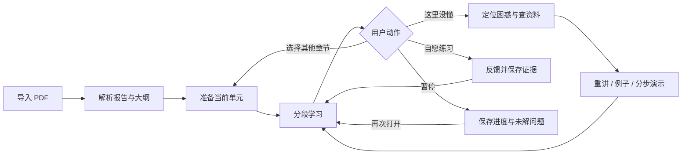
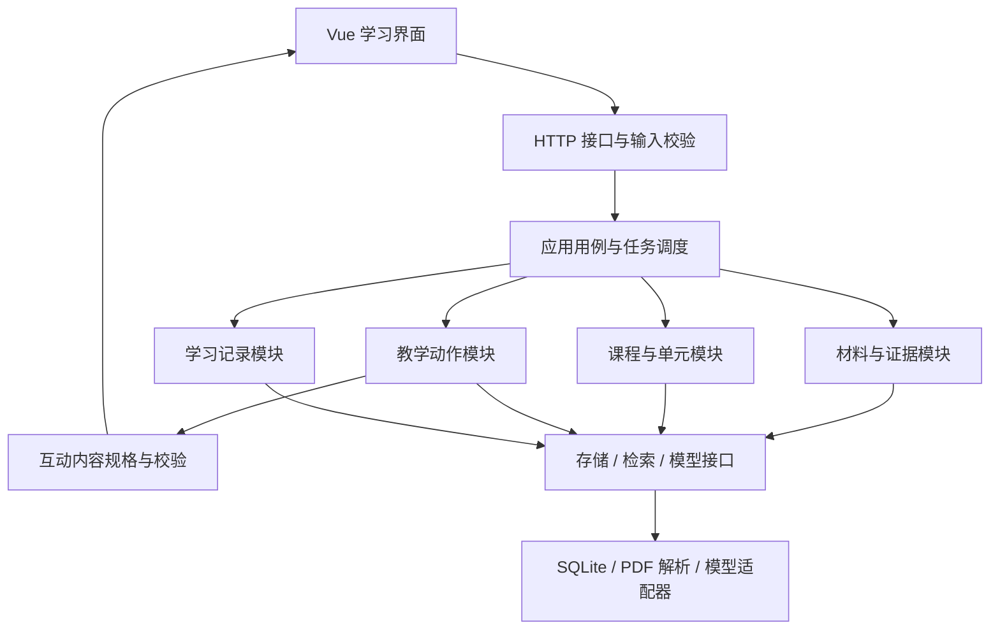
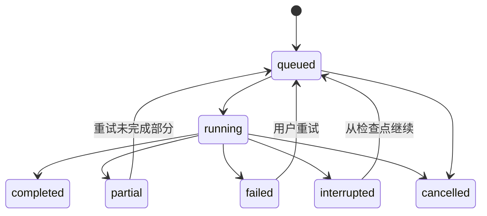

# 个人学习 Agent 项目文档

> 版本：v0.1 · 更新日期：2026-11-05 · 状态：设计基线；已开始实现，实际完成情况见 [开发进度](开发进度.md)
> 使用对象：项目开发者本人、后续协作者及面试演示准备。
> 阅读路径：先读第 1–5 节确定产品，再读第 6–11 节实施，第 12–15 节用于评测与交付。

**一句话定义：把 PDF 或一个学习主题转化为有出处、可持续推进的个人学习过程；Agent 根据当前知识点和用户困惑选择讲解、例子、图解或代码实验，保存进度与反馈，由用户决定何时进入下一章。**

本文使用三种标记：**已确认**来自用户明确表达；**建议默认**是结合两到三周开发周期作出的实现选择；**后续阶段**保留在产品愿景中，暂不计入首版交付。所有效果数字与性能指标均需实测，本文没有宣称项目已经达到某种表现。

## 1. 项目概览与决策依据

| 项目项 | 内容 |
| --- | --- |
| 首位用户 | 开发者自己：不容易持续阅读长 PDF，也不希望花大量时间搜索整理学习资料 |
| 双重目标 | 改善自己的学习体验；学习 Python 与 Agent 开发，形成能够解释设计、展示结果的面试作品 |
| 开发约束 | 两到三周先做可演示版本；开发者较熟悉 Java/Vue，愿意学习 Python；每周投入小时数尚未确定 |
| 完整输入愿景 | 上传 PDF，或输入主题，例如“学习 Python” |
| 首版建议范围 | 以给定 AI Agent 教材为验证材料，支持可提取文本的 PDF，重点打磨首章及少量学习单元 |
| 核心价值 | 少花时间重新找进度、描述问题和挑选材料；遇到困惑时能获得合适的教学帮助 |
| 工程重点 | 有依据的生成、受约束的工具选择、持久化学习状态、增量生成与失败恢复、可复现评测 |

**三层上探的结论。** 做项目的直接原因是学习启动与材料整理负担；进一步的目标是学会应用知识，并能讲清自己开发的系统；更合适的投入方式是先完成一个范围明确的学习流程，借鉴成熟开源设计，再按真实使用中的缺口扩展。

**四个专家视角。** 顶尖实现者还会补齐解析覆盖报告、先修知识、来源核对、用户纠正记忆、失败恢复与评测。材料优先使用原始教材、作者代码、官方文档和原始研究。分析方法采用学习目标拆分、明确状态、有限动作选择和同条件对照；外部依据来自原文、真实执行结果、操作记录及独立应用题。框架名字、内容数量或模型自评分不独立构成质量证明。

项目值得做的前提是能够亲自解释核心决策。若当前唯一目标是尽快学习，使用已有产品更省开发时间；考虑到 Python 学习和工程作品目标，自己实现小型核心具有价值。已有开源功能与本愿景重合，作品应准确说明借鉴内容和个人贡献。

## 2. 已确认需求与设计假设

| 决策 | 状态 | 约束或说明 |
| --- | --- | --- |
| 自己是首版用户 | 已确认 | 先针对真实自用流程优化 |
| 用户自己决定下一章 | 已确认 | 小测、模型判断和阅读时长均不得成为强制解锁条件 |
| 每日任务按实际进度调整 | 已确认 | 不机械积压未完成任务；首版无需定时推送 |
| 记忆至少包含学习进度 | 已确认 | 刷新或重新打开后可以继续 |
| 先有大纲，再逐步准备内容 | 已确认 | 不预先完成整门课程；用户推进时继续生成 |
| 互动区按需出现 | 已确认 | 可以没有，也可以是代码或动画；由内容或用户困惑触发 |
| Agent 决定如何帮助理解 | 已确认 | 可以重讲、举例、图解；无法定位困惑时允许先问一句 |
| 高内聚、低耦合，优先借鉴开源 | 已确认 | 模块职责、数据归属和依赖方向需要明确 |
| PDF 优先，主题研究稍后接入 | 建议默认 | 这是开发顺序建议，未取消主题输入这一完整需求 |
| Vue 3 前端、Python 后端 | 建议默认 | 利用已有前端经验，把新学习投入集中在 Python 与 Agent |
| 首版单用户、本机运行 | 建议默认 | 云端部署、多账户与权限系统暂不计入核心交付 |
| 保存未解疑问、已尝试讲法及反馈 | 建议默认 | 为续学和教学选择提供最小必要上下文 |
| 首版一个步骤演示组件，代码运行区可选 | 建议默认 | 先验证动态呈现流程，通用代码执行能力列入扩展 |

实现前需要落定的参数包括模型提供方、调用预算、每周可投入时间和演示部署位置。这些不影响本文的业务边界；脚手架可先通过可替换模型接口和配置项推进。正式展示前应锁定依赖版本、模型标识和使用的开源提交版本。

## 3. 产品范围与优先级

优先级含义：P0 是首版学习流程所必需；P1 在 P0 可用且通过关键验收后加入；P2 为后续迭代。

| 编号 | 功能 | 优先级 | 首版边界 |
| --- | --- | --- | --- |
| F01 | PDF 导入、解析与覆盖报告 | P0 | 文本型 PDF；保留物理页位置；无法解析的页明确提示 |
| F02 | 大纲和学习目标 | P0 | 允许审阅与小幅调整；展示尚未准备的章节 |
| F03 | 按需生成小节内容 | P0 | 一个知识点一个主要目标；先准备当前学习单元，不自动生成整本书 |
| F04 | 带出处的课内问答 | P0 | 回答与当前章节、选中段落绑定；材料不足时说明缺口 |
| F05 | 困惑处理与教学动作选择 | P0 | 重讲、例子、步骤图；定位不清时问一个简短诊断问题 |
| F06 | 一键续学与进度更新 | P0 | 恢复到单元、内容块和未解疑问；用户可自由切章 |
| F07 | 可查看和更正的学习记录 | P0 | 区分读过、自述理解和练习证据；不显示无依据的掌握百分比 |
| F08 | 当次学习任务 | P0 | “继续当前内容＋可选复习”；按进度和可用时间更新 |
| F09 | 自愿微练习 | P0 简版 | 一句复述、一道预测或应用题；跳过后仍可继续 |
| F10 | 生成状态、取消和局部重试 | P0 | 保留已成功内容；重连可恢复；避免重复生成 |
| F11 | 可暂停、可逐步推进的图解 | P0 一种 | 首先支持流程或状态变化；内容由 Agent 生成，渲染由受控组件负责 |
| F12 | 有限 Python 练习区 | P1 | 仅少量纯逻辑练习；不承诺运行教材全部实验 |
| F13 | 先修知识补充卡 | P1 | 卡住时补一个基础概念；暂不构建大型先修图谱 |
| F14 | 主题输入与可信资料搜索 | P2 | 目标澄清、来源筛选、检索预算、证据记录后接入统一课程流程 |
| F15 | 多材料与更复杂的检索 | P2 | 根据检索失败案例决定是否增加向量检索、重排和专用存储 |

首版暂缓任意视频生成、语音数字人、多导师群聊、社交积分、复杂知识追踪、自动自我优化和通用在线 IDE。理由是它们扩大生成、运行与核验边界，当前尚未证明优先于续学和困惑处理。

## 4. 用户流程与界面

**首次使用。** 上传 PDF → 查看解析结果 → 输入或沿用学习目标 → 审阅大纲 → 选择起始章节 → 准备第一个学习单元。背景和可用时间可以简短填写，不应变成长问卷。生成期间展示当前步骤，并允许离开后继续。

**日常学习。** 打开课程 → 看见上次位置和一个待解问题 → 确认本次可用时间 → 继续讲解 → 自由追问、查看演示或尝试练习 → 暂停或自行进入其他章节。任务基于当前状态重新安排，不因缺席产生惩罚式欠账。

**困惑处理。** 用户选中一段讲解或直接说“这里不明白” → 系统定位当前内容，读取最近相关解释和来源 → Agent 选择下一教学动作 → 展示内容并提供自愿反馈 → 保存结果。若未理解，再尝试另一种有理由的方式；不会因一次“我懂了”永久认定掌握。



**界面建议。** 桌面界面左侧为章节目录，中间为学习正文，右侧为问答与按需互动区域；用户也可以折叠侧栏集中阅读。没有互动内容时不占据空白演示区。用户提问自动携带当前内容块；来源在侧边抽屉展示原文片段和原始页位置。系统日志、token 和策略诊断放在开发调试视图。

首屏只突出“继续上次”和当次目标。学习页提供“换个例子”“这里没懂”“练一下”“稍后继续”这些明确动作；章节目录始终可自由选择。取消生成不会清空已有内容。

**教材演示场景。** 用户学习工具调用后问：“为什么工具返回结果后，还要调用一次模型？”Agent 查找对应原文，选择消息流步骤图：提出工具调用 → 执行工具 → 把返回值加入消息 → 下一次模型调用依据结果回答。用户可以暂停、改变示例返回值并预测下一步。展示的是程序消息与状态变化，不宣称展示模型隐藏思维。

## 5. 功能需求与验收条件

以下验收是设计要求，尚未执行。

| 场景 | 系统行为 | 可检查的结果 |
| --- | --- | --- |
| 上传给定教材 | 解析目录与文本，保存来源版本和页位置 | 明确成功、部分成功、失败页；不把空白抽取结果认作完整解析 |
| 创建课程 | 生成可审阅大纲及当前单元 | 待生成章节可见；用户无需等待全书生成才开始 |
| 用户切章 | 提交明确导航指令；必要时准备目标单元 | 未参加练习也可跳章；Agent 无权自行改变当前章节 |
| 表示不理解 | 携带当前块、选中范围、近期相关问答 | 不要求用户重复粘贴已有上下文；模糊时允许短问句定位 |
| 选择演示 | 生成结构化演示数据并验证 | 组件正常渲染，步骤符合资料；无演示也能继续学习 |
| 查看来源 | 展示原文片段、物理页与文档版本 | 页号对应原文件；正文编号与文件页号不混用 |
| 刷新或重启 | 从持久化状态恢复 | 恢复最近已保存的块、未解问题和已生成内容 |
| 用户修正记忆 | 保存更正事件并更新有效状态 | 后续上下文不继续使用已被纠正的结论 |
| 做题或跳过 | 保存实际反馈或跳过记录 | 跳过不记为做错；做对且有提示不记为独立完成 |
| 生成中断 | 保留有效内容，标注未完成块 | 只重试未完成部分；不会重复写进度或出现两份相同内容 |
| 材料没有答案 | 说明当前资料不足，给出可行下一步 | 不虚构引用，不把模型常识标注为 PDF 原文 |

重要事实应关联能够支持它的来源片段。教学类比、练习题和假设示例需标明性质；它们可以是生成内容，但不得伪装成原作者观点或已发生的实验结果。

## 6. Agent 决策与工具设计

首版采用**一个教学协调 Agent＋明确的业务流程与工具**。材料解析、状态更新和版本检查由普通程序负责；Agent 根据学习目标、证据和用户反馈选择教学动作。模块数量不等于 Agent 数量。

每次请求的工作过程为：构造有限上下文 → 检索需要的证据 → 判断是否需要澄清 → 选择动作 → 生成结构化内容 → 校验并呈现 → 保存操作与反馈。用户下一章的决定发生在这套流程之外，由显式用户操作触发。

| 可选动作 | 合适情形 | 结果 |
| --- | --- | --- |
| `answer` | 普通课内问题 | 有出处的直接回答 |
| `clarify` | 无法定位具体困惑 | 一个简短问题，本轮等待用户回答 |
| `reexplain` | 概念、术语或表达难懂 | 更短或更具体的解释 |
| `worked_example` | 定义懂了但不知道如何应用 | 一个例子，必要时附反例 |
| `step_diagram` | 卡在顺序、状态或因果关系 | 可暂停、逐步推进的图解 |
| `code_demo` | 程序行为需要运行观察且能力已启用 | 受限代码实验；P1 |
| `micro_exercise` | 用户愿意检查理解 | 一个可独立尝试的小任务 |

这是待评估的初始动作策略。用户展示偏好可作为线索，不能据此固定归类为“视觉型学习者”。决定依据应包括当前概念、具体困惑、证据可用性和之前尝试的效果。

模型输出必须包含动作类型、简短理由代码、来源 ID 和内容规格。理由可以是“涉及三步状态变化”，无需展示或保存模型内部推理。若来源不足，应选择澄清、检索或说明限制，不能凭高置信度措辞绕过校验。

建议提供的工具接口：

| 工具 | 职责 | 边界 |
| --- | --- | --- |
| `read_current_context` | 获取当前单元、选中块与版本 | 只读取当前课程作用域 |
| `search_material` | 在指定材料与章节中查找证据 | 返回真实片段 ID 和检索位置 |
| `get_source_spans` | 读取片段原文及邻近上下文 | 防止断章取义，校验所属材料 |
| `read_learning_record` | 获取相关未解问题、已试讲法与反馈 | 不默认载入全部历史对话 |
| `build_step_diagram` | 创建受支持的步骤演示规格 | 只生成组件数据，不执行任意脚本 |
| `run_python_example` | 执行受限示例；P1 | 不接触服务端密钥或主机文件 |

学习事件由应用服务在工具结果和用户反馈到达后保存；模型不能直接写数据库，也没有“自动推进到下一章”的工具。

**初始预算建议。** 单次辅导最多 4 次模型调用、5 次工具调用；结构修复最多一次；超时或预算耗尽后返回已有有效结果与重试入口。这是防止无界循环的配置起点，需根据实际模型调整。选择 `clarify` 后结束本轮；用户反馈未知时不得自行模拟用户理解。

## 7. 记忆与课程状态

三类信息采用不同职责：材料库保存“资料说了什么”；学习状态保存“用户做了什么、停在哪里”；会话上下文保存“这一轮正在讨论什么”。聊天摘要可帮助整理，但不能作为课程进度的唯一事实来源。

| 记录 | 最小字段 | 更新规则 |
| --- | --- | --- |
| 导航进度 | 当前课程、单元、内容块、阅读位置、版本、保存时间 | 由用户导航和阅读动作更新；与掌握判断独立 |
| 未解疑问 | 关联概念、问题、相关来源、已试讲法、解决反馈 | 根据实际对话追加；保留待确认状态 |
| 学习证据 | 是否读过、用户自述、练习提交、是否使用提示、结果和时间 | 分字段或事件保存，不压缩成单一百分比 |
| 当前任务 | 目标、预计时间、依据的进度版本、完成或跳过状态 | 进度或可用时间改变后重排；不无限累积 |
| 展示偏好 | 长短、例子类型、用户主动选择的表现形式 | 用户可修改；不推断能力或固定学习类型 |
| 续学摘要 | 上次目标、停点、一个未解问题、关联事件 ID | 从记录生成，可被更正；不能覆盖原始事件 |

**写入规则。** 用户明确陈述保存为用户陈述；练习结果保存为可核对事件；模型推断单独标记并关联依据。用户说“我懂了”只更新自述字段，点击下一章只更新导航字段。一次答对记录为本次成功，不永久升级为已经掌握。

**读取规则。** 默认按用户与课程限定范围，优先当前单元和相关前置知识；取最近相关记录与少量摘要，保留原事件的可追溯性。不同课程的信息不自动混入当前教学。

**更正规则。** 更正形成新事件，指向被更正项；后续有效视图排除旧结论并使依赖摘要失效。取消、更正或隐藏记录不应让原始错误结论继续参与教学策略。

**一致性规则。** 进度使用递增版本处理多个标签页冲突。重复事件按请求 ID 去重；导航事件与对应状态更新在同一事务中完成。网络请求失败时界面标注尚未保存，不能静默显示为已保存。

## 8. 材料处理、知识库与可信来源

**PDF 首版管道：** 保存原文件及哈希 → 按页提取 → 识别章节 → 建立原文片段 → 生成解析覆盖报告 → 建立可检索索引 → 生成课程大纲。材料内的命令、提示词和代码均作为学习内容处理，不自动转化为系统指令或执行动作。

每个片段保留 `document_id`、材料版本、章节路径、零起始物理页索引、原文和可选文本位置。面向用户显示文件页号时加一；书本印刷页码作为独立可选标签。该教材包含前置页，不能直接把章节页码当作文件页号。

首版建议使用章节和邻近上下文定位，再加支持中文分词的关键词检索。召回结果不足时可以扩大章节范围；是否增加向量检索和重排，由固定问题集中的召回失败决定。中文长文检索需实际检查分词与匹配质量，不能默认套用英文全文检索配置。

课程内容与索引分开保存。即使资料很多，也只把当前需要的片段放入模型上下文。生成课程不要求先逐章撰写全部讲义；先识别全局目录和依赖，再深入处理当前单元。首版不保证复杂表格、图中文字、公式和扫描页都可解析，覆盖报告必须暴露缺口并提供查看原页的入口。

**主题研究后续管道：** 澄清目标、基础和时间 → 列出需要覆盖的知识 → 选择来源渠道 → 检索并读取原始页面 → 去重、核对与记录证据 → 建立学习大纲 → 接入同一课程流程。

| 内容 | 首选证据 | 补充检查 |
| --- | --- | --- |
| Python 或工具用法 | 官方文档、维护者源码和示例 | 版本是否匹配，示例是否真实运行 |
| 科学结论 | 原始论文、实验与数据；综述用于定位背景 | 同行评审状态、适用对象、方法与争议 |
| AI Agent 工程经验 | 作者仓库、可运行案例、官方技术资料 | 区分作者主张、演示样例和独立验证 |

来源记录包含标题、作者或机构、原始链接、发布日期或版本、访问时间、内容哈希和具体片段。权威机构名称是筛选线索，仍需检查原文是否真正支持讲解。预印本、相互冲突或缺少原文的证据要标明状态。

搜索设置来源数量、调用次数和总耗时预算；当学习目标已有足够证据且关键分歧已说明时停止。达到预算仍有空缺时列出空缺。后续可保存知识索引供复用，但不以搜集材料总量作为成功标准。

## 9. 系统架构与模块边界

建议采用模块化单体。首版一个前端、一个 Python 应用和本地持久存储，模块内聚合本职责的数据与规则，通过明确接口协作。



| 模块 | 拥有的职责 | 应避免的依赖 |
| --- | --- | --- |
| 材料与证据 | 原文件、解析状态、片段、来源版本和检索 | 不负责更新用户进度 |
| 课程 | 大纲、学习目标、前置关系、内容版本 | 不负责选择具体模型 SDK |
| 教学 | 根据上下文和反馈选择动作、组织回答 | 不直接写数据库或拼接页面 DOM |
| 学习记录 | 导航、证据、疑问、更正、续学状态 | 不凭生成内容自动改变章节 |
| 互动内容 | 组件协议、参数校验、结果状态 | 不自行决定课程进度 |
| 应用与任务 | 组合用例、事务边界、幂等和取消 | 不堆放具体教学提示词 |

依赖方向：API → 应用用例 → 领域模型与接口。基础设施适配器实现接口，由启动模块注入；核心逻辑不依赖 FastAPI、某模型 SDK 或前端组件。更换模型只改适配层，更换存储主要改仓储实现，新增演示类型主要改组件协议和生成器。

**建议技术选型与理由：**

| 层 | 建议默认 | 取舍 |
| --- | --- | --- |
| 前端 | Vue 3、TypeScript、Vite | 沿用 Vue 经验；类型约束辅助校验内容块协议 |
| 后端接口 | Python、FastAPI | Python 类型驱动的 API 与自动接口说明，便于前后端对接 |
| 数据校验 | Pydantic | 校验模型输出结构、动作枚举与字段；事实正确性仍需单独核对 |
| 存储 | SQLite、本地材料目录 | 适合单用户演示；数据库记录状态，文件保存原材料 |
| PDF 提取 | 通过 `PdfParser` 接口接入 Python 解析库，优先试用 pypdf | 先在给定教材抽样检查；复杂版式再评估替代解析器 |
| 编排 | 明确的 Python 状态流程与工具接口 | 先保证流程可追踪；若恢复和分支复杂度上升，再评估 LangGraph |
| 互动 | Vue 受控步骤组件；P1 评估 JupyterLite/Pyodide | 步骤图先行，代码执行能力按真实练习需求加入 |
| 可观测性 | 本地结构化事件与运行记录 | 记录工具、状态、模型用量、校验与失败；外部追踪服务可后接 |

上述为项目建议，未锁定具体依赖版本。[Vue 官方介绍](https://vuejs.org/guide/introduction.html)、[FastAPI 文档](https://fastapi.tiangolo.com/)、[Pydantic Models](https://pydantic.dev/docs/validation/latest/concepts/models/)提供对应能力说明。LangGraph 的 checkpointer 与跨会话 store 可用于后续编排，但不能替代本项目的业务进度与学习证据模型；内存态 checkpoint 也不能保证进程重启后的恢复。[LangGraph 持久化说明](https://docs.langchain.com/oss/python/langgraph/persistence)

建议目录只作为脚手架约定，当前尚未创建产品代码：

```text
web/src/
  features/course/       # 课程目录与正文
  features/tutor/        # 上下文问答
  features/learning/     # 进度和学习记录
  components/artifacts/  # 步骤图、后续代码区
server/app/
  api/                  # HTTP 协议与错误映射
  application/          # 用例、事务和动作编排
  domain/               # 领域模型与业务规则
  ports/                # 模型、检索、存储接口
  adapters/             # 具体模型、解析器和 SQLite
  jobs/                 # 任务运行、取消与恢复
  bootstrap.py          # 依赖组装
evals/                  # 固定案例、评分依据和运行记录
docs/                   # 项目文档与架构决策
```

## 10. 核心数据与接口契约

以下为最小逻辑实体，不要求每个实体对应独立服务。实现时可以合并简单表，但保留各自语义。

| 实体 | 关键字段与关系 |
| --- | --- |
| `Document` | ID、哈希、版本、文件位置、页数、解析状态与缺漏报告 |
| `SourceChunk` | ID、文档版本、章节路径、起止物理页索引、原文；属于一个材料版本 |
| `Course` / `Unit` | 目标、大纲版本、排序、前置单元、学习目标、材料版本引用 |
| `LessonBlock` | 单元、内容版本、块类型、正文或组件数据、来源片段、校验状态 |
| `LearnerState` | 用户和课程、当前单元与块、阅读位置、计划版本、递增状态版本 |
| `LearningEvent` | 类型、发生时间、对象、用户陈述或观察结果、证据引用、更正关联 |
| `TutorTurn` | 请求上下文、动作、理由代码、工具调用、使用的来源、产物与运行指标 |
| `Job` | 请求 ID、类型、目标版本、任务状态、检查点、重试次数、错误与取消标记 |

内容版本与进度绑定。修改大纲或重新生成内容时创建新版本，保留已读版本；若旧位置无法映射，提示用户选择目标位置，不静默跳到其他知识点。原 PDF 改版也应创建新材料版本。

**共享协议示意：**

```typescript
type SourceAnchor = {
  documentId: string;
  documentVersion: string;
  chunkId: string;
  pageIndexStart: number; // 文件物理页，0 起始
  pageIndexEnd: number;   // 含末页
};

type TeachingAction = {
  action: "answer" | "clarify" | "reexplain" | "worked_example"
        | "step_diagram" | "code_demo" | "micro_exercise";
  reasonCode: string;     // 简短、可观察的选择依据
  sourceChunkIds: string[];
  artifactType?: "step_flow" | "python";
};

type StepDiagram = {
  schemaVersion: 1;
  type: "step_flow";
  title: string;
  steps: Array<{ id: string; label: string; explanation: string }>;
  sourceAnchors: SourceAnchor[];
};
```

后端将来源 ID 解析为实际片段并校验归属，不直接相信模型填写的页号。步骤组件限制枚举、数量和文本长度；模型返回任意脚本或不支持的组件类型时拒绝该规格并回退到文字。JSON 结构合法仅表示可处理，不表示教学内容已正确。

**HTTP 接口建议：**所有创建任务与写学习事件的请求携带稳定 `request_id`；进度修改携带 `expected_version`。ID 由服务端核对归属。

| 方法与路径 | 用途与主要结果 |
| --- | --- |
| `POST /api/documents` | 上传文件，返回 `document_id` 和解析 `job_id` |
| `GET /api/documents/{id}` | 获取解析状态、覆盖报告与材料版本 |
| `GET /api/documents/{id}/chunks/{chunk_id}` | 获取引用原文及实际页位置 |
| `POST /api/courses` | 基于已可用材料创建课程和大纲任务 |
| `GET /api/courses/{id}` | 获取大纲、章节状态与当前内容版本 |
| `PATCH /api/courses/{id}/outline` | 修改大纲并显式更新版本 |
| `POST /api/courses/{id}/units/{unit_id}/prepare` | 幂等准备指定单元，返回已有结果或任务 ID |
| `POST /api/courses/{id}/tutor-turns` | 发送当前块、选中范围和问题，返回辅导任务 ID |
| `PATCH /api/courses/{id}/progress` | 用户导航或阅读位置更新；返回新状态版本 |
| `GET /api/courses/{id}/resume` | 返回续学位置、有效学习记录与未解问题 |
| `POST /api/courses/{id}/learning-events` | 提交自述、练习、跳过及更正事件 |
| `POST /api/courses/{id}/session-plan` | 根据最新进度与可用时间生成当次小任务 |
| `GET /api/jobs/{id}` | 查询状态、已保存产物、错误与可重试项 |
| `POST /api/jobs/{id}/cancel` | 标记取消，保留已完成产物 |

先用任务轮询即可完成异步交互；若增加 SSE，接口沿用同一任务 ID 与事件序号。传输连接不作为任务或学习状态的唯一存储。推荐错误类型包括 `PARSE_INCOMPLETE`、`SOURCE_UNAVAILABLE`、`MODEL_TIMEOUT`、`OUTPUT_INVALID`、`VERSION_CONFLICT`，界面展示对应的人可理解说明。

## 11. 增量生成与失败恢复

**内容生成原则。** 先有全局大纲，再准备当前单元；可在预算内预备当前章的下一单元。预备内容不更新用户阅读位置。每个内容块验证后立即保存，后续块失败不会撤销已完成块。

任务状态可采用：



请求去重与产物去重分别处理：相同 `request_id` 返回同一请求结果；课程、单元、内容版本和任务类型组成业务唯一键，即使请求 ID 不同，也复用同一目标的进行中任务或已完成产物。用户明确要求重新生成时创建新的内容版本。块保存与检查点更新放在同一事务中，失败恢复时先检查已经提交的块，再发起模型调用。断线后重新获取任务状态，不重复启动整章生成。

首版建议只允许一个任务执行器，任务持久化在数据库。应用重启时识别遗留运行任务为中断状态，提供从检查点继续的入口；不要依赖纯内存队列宣称可恢复。扩展多个 worker 时再引入任务租约和队列基础设施。

| 异常 | 首版处理 |
| --- | --- |
| PDF 部分页无法提取 | 标注缺漏；允许阅读原页；课程不能声称覆盖该页内容 |
| 模型超时或限流 | 有界重试；预算耗尽后保留已有内容和手动重试入口 |
| 模型输出格式错误 | 校验后修复一次；仍失败则给出可继续的文字或明确失败 |
| 图解无法渲染 | 保留正文，标注演示未生成；允许局部重试 |
| 前端关闭或断网 | 后端按策略继续或取消任务；重新连接以数据库状态为准 |
| 并行标签页修改进度 | 版本冲突时提示并同步最新状态，不静默覆盖 |
| 无资料支持回答 | 说明资料缺口；P2 可建议受预算约束的补充搜索 |

运行记录至少包含运行 ID、模型标识、提示模板版本、来源片段 ID、动作、工具结果、耗时、用量和错误类型。没有模型费用配置时显示“费用未知”，不能记录成零。普通用户界面不需要展开这些开发细节。

代码运行区若进入 P1，应采用独立受限环境和超时机制。浏览器内的 Python 可以复用 JupyterLite/Pyodide，但有包与系统能力限制；模型密钥留在服务端，生成代码不能在后端主进程直接执行。已有官方浏览器运行能力并不保证教材的每个实验都兼容。[JupyterLite 嵌入方式](https://jupyterlite.readthedocs.io/en/stable/quickstart/embed-repl.html)、[兼容性说明](https://jupyterlite.readthedocs.io/en/stable/troubleshooting.html)

## 12. 评测与质量标准

项目分别检查工程正确性、教学回应质量与用户学习表现。以下是拟采用的验证方式，全部待实际实现后执行。

| 维度 | 测量方式 | 首版判定 |
| --- | --- | --- |
| 来源可靠性 | 人工对照抽样事实与引用片段；统计支持数/核查数和缺失引用数 | 演示路径中的关键事实全部核查，不能存在已知伪造引用 |
| 进度与恢复 | 固定操作序列：切章、暂停、刷新、重启、重复提交 | 关键流程必须准确恢复；无用户指令时不能自动推进章节 |
| 记忆更正 | 写入错误记录后纠正，再查询与继续教学 | 旧结论不再作为有效事实注入上下文 |
| 困惑处理 | 对人工标注场景检查定位、解释变化、证据和下一步 | 存在多种合理动作，不机械以唯一动作作为答案 |
| 互动内容 | 分别检查可渲染性与教学步骤正确性 | 渲染成功不能替代内容核验；失败不阻断正文 |
| 可选代码 | 独立设计输入输出或隐藏样例 | 既能运行也符合预期语义；错误和超时可见 |
| 性能与成本 | 首个可学习单元耗时、辅导响应耗时、失败率和模型用量 | 用固定材料与模型报告实测分布；基线后再设合理预算 |
| 学习表现 | 学习前、学习后、隔日的不同应用或复述任务 | 作为自用观察，不据单人短期结果宣称普遍增益 |

**案例集建议。** 初步准备 24 个场景：6 个有材料依据的问题、4 个资料不足或错误前提、5 个不同类型的困惑、5 个导航和恢复场景、2 个记忆更正、2 个重复生成或输出失败。先固定其中 6 个作为保留集，不用于调整提示词；保留集以后用于调优时，需补建新的独立保留集。

同一材料和模型下，用“普通摘要＋问答”作为一个基线，比较定位知识点的操作、引用支持情况、恢复结果、困惑后的应用任务、延迟与调用量。若比较 DeepTutor，应固定版本、模型、输入和问题，并注明功能范围差异；当前没有实测优势结论。

教学评分可借鉴 MRBench 中错误定位、引导与可行动性的维度，但它是数学辅导基准，不能直接用其分数证明本项目的 Agent 教学效果。[MRBench](https://aclanthology.org/2025.naacl-long.57/)

主动回忆及分段演示有学习研究依据，但方法有效不等于本应用已有效；动画是否必要由概念与反馈决定。测量时区分有提示完成和独立完成，避免只重复练过的原题。[主动回忆原始研究](https://www.psychologicalscience.org/journals/psychological-science/j.1467-9280.2006.01693.x/)、[分段控制动画研究](https://tecfa.unige.ch/tecfa/teaching/methodo/Mayer_Chandler01.pdf)

**首版发布条件：** P0 核心路径通过验收；演示素材与出处人工核对；恢复、手动推进和更正记忆不存在已知阻断问题；有一份包含样本量、失败案例、模型版本和运行记录的评测结果。需求覆盖与实际表现分别报告。

## 13. 两到三周开发计划

时间安排为顺序建议，不是工期承诺。每一阶段先达到可演示状态，再加入新能力。两周版本以可靠 P0 为边界，第三周是否做代码区取决于已有质量和剩余时间。

| 阶段 | 主要工作 | 阶段交付 | 退出条件 |
| --- | --- | --- | --- |
| 第 1 周前半 | 抽样检查 PDF、建立材料与课程模型、前后端骨架、模型适配接口 | 能导入材料并查看解析报告 | 页位置与原文可核对；接口能处理失败 |
| 第 1 周后半 | 大纲、首个学习单元、正文与来源、手动导航和续学存储 | 一个章节的基本阅读问答流程 | 刷新后能接着学，跳章由用户控制 |
| 第 2 周前半 | 当前块提问、教学动作选择、一个步骤组件、未解问题记录 | “这里没懂”的完整辅导流程 | 能选择重讲或演示，保存真实反馈 |
| 第 2 周后半 | 自愿微练习、任务简版、取消与局部重试、固定场景评测 | 两周可演示版本 | P0 关键路径通过；记录实际不足 |
| 第 3 周可选 | 修复试学问题；有余力增加有限 Python 区或先修卡；整理部署与演示 | 可重复演示和复现的作品 | 核心功能不被扩展破坏，评测有原始记录 |

可执行工作项：

- [ ] T01：在目录、普通文字、代码和图表所在页抽样检查提取结果，确定解析器。
- [ ] T02：实现材料版本、来源片段和引用回查接口。
- [ ] T03：实现大纲与当前单元生成，限定不自动生成全书。
- [ ] T04：完成正文、目录、上下文提问及来源抽屉。
- [ ] T05：完成导航进度、学习事件、续学和用户更正。
- [ ] T06：实现有限教学动作协议与输出校验。
- [ ] T07：完成一个真实可操作的分步组件及文字回退。
- [ ] T08：加入当次任务与自愿练习，保持章节自主推进。
- [ ] T09：实现持久化任务、幂等、取消和局部重试。
- [ ] T10：完成固定案例、必要的集成检查、试学记录和演示材料。

依赖关系：T02 支撑 T03/T04/T06；T05 支撑 T08；T06 支撑 T07。T09 应随着生成流程开发，T10 的案例在前期就开始记录。先修卡和代码区是扩展项，不能挤占核心可靠性工作。

## 14. 开源借鉴与个人贡献

下表来自 2026-11-04 的公开文档与部分源码检查，未安装运行竞品。动态教学与渐进课程已有先例，以下借鉴不是对完整产品质量的背书。

| 项目 | 已查到的参照 | 推荐借鉴 | 需要避免的误解 |
| --- | --- | --- | --- |
| DeepTutor | Books 支持大纲与只生成第一章；内容模型含代码、互动和动画块 | 内容块协议、逐块保存、重复任务合并、模块依赖约束 | 有代码块不等于该块已运行正确；不能宣称这些功能首次出现 |
| OpenTutor | 课程范围内辅导笔记、会话暂停恢复与教学策略记录 | 简单续学状态、可追溯教学笔记 | 前后掌握分变化不独立构成策略有效的因果证据 |
| Learn-With-AI | 官方说明逐知识点教学、选中文本提问、互动图解 | 问题绑定当前材料、复述式学习反馈 | 部分展示是人工编排样例，不能当作生成质量实测 |
| JupyterLite/Pyodide | 浏览器内运行 Python 与嵌入能力 | 有限代码练习组件 | 不等同完整服务端 Python 或通用沙箱平台 |
| 教材作者仓库 | 与给定 PDF 对应的正文与章节实验 | 第一份课程材料、概念和练习的原始依据 | 发布教材或复制实验时需逐项核对适用许可与版本 |

DeepTutor 可重点阅读 [BookEngine](https://github.com/HKUDS/DeepTutor/blob/main/deeptutor/book/engine.py)、[BookCompiler](https://github.com/HKUDS/DeepTutor/blob/main/deeptutor/book/compiler.py)、[内容模型](https://github.com/HKUDS/DeepTutor/blob/main/deeptutor/book/models.py)与[依赖约束](https://github.com/HKUDS/DeepTutor/blob/main/.importlinter)。它们提供了具体设计参考；移植前仍需在锁定版本上检查兼容性、许可证及实际行为。

个人实现重点建议记录为：课程及学习状态契约、针对当前困惑的动作选择、可更正的证据记忆、受控互动呈现、失败恢复与评测。解析器和基础组件优先复用，避免把第三方代码写成自己从零完成。

项目交付时维护依赖与借鉴清单，标明仓库、版本、许可证、使用范围和改动；保留要求的许可说明。尚未实际采用的项目只记为设计参考。

## 15. 演示、交付与后续迭代

**建议演示脚本（约 5 分钟，时间仅为展示安排）：**

1. 打开课程，展示大纲、已准备和待准备的章节，以及上一处停点。
2. 继续一段讲解，打开出处并核对原 PDF 文件页。
3. 选中工具调用相关内容说“我还是不明白”，展示 Agent 的选择及分步组件。
4. 改变示例返回值或回答一道自愿预测题，展示记录的反馈。
5. 刷新页面，证明学习位置和未解问题仍在；修正一条记录并继续。
6. 主动进入另一章，展示按需准备；补充一个失败后局部重试和实际评测记录。

**交付清单：**

- 能运行的前后端项目、配置样例和依赖锁文件；模型密钥由环境配置提供。
- 清楚的启动步骤、支持的 PDF 类型、代码运行边界和已知限制。
- 本项目文档、关键架构决策、接口说明、开源借鉴清单。
- 经核对的演示资料；若原教材不适合随仓库分发，使用获许可摘录或自制样例。
- 固定评测案例、人工评分依据、运行记录和失败修复说明。
- 简短演示录像或操作步骤；简历描述只使用真实实现与实测结果。

面试可以围绕几个具体问题展开：为什么进度与掌握证据分开，怎样限制模型动作，如何确保引用落到原材料，怎样处理断线和重复生成，以及何时应该增加更复杂的检索或编排框架。描述结果时保留样本数量、模型和输入条件，不使用未经测量的效率提升数字。

后续迭代顺序建议：先根据本人使用修复最常见中断点 → 增加有限代码练习与先修补充 → 接入带出处和预算的主题研究 → 根据材料规模升级检索 → 有真实多用户需求后再处理账户、部署和资源隔离。每次扩展继续先确认目标、原始证据、可借鉴实现和外部验收方式。

## 16. 参考资料与变更记录

| 资料 | 用途 |
| --- | --- |
| [前期功能取舍报告](../reports/个人%20学习%20Agent%20功能%20取舍.md) | 用户目标、竞品核查和取舍依据 |
| [AI Agent 教材与配套仓库](https://github.com/bojieli/ai-agent-book) | 首个学习材料和实验参考；原 PDF 为用户提供的 313 页版本 |
| [DeepTutor Books](https://docs.deeptutor.info/explore/book/) | 大纲、渐进生成与内容形式 |
| [DeepTutor Memory](https://docs.deeptutor.info/explore/memory/) | 记忆组织参考；与本项目简版记忆边界对照 |
| [OpenTutor](https://github.com/zijinz456/OpenTutor) | 学习会话和课程辅导参考 |
| [Learn-With-AI](https://porridgeowefish.github.io/Learn-With-AI/en/) | 上下文提问与逐知识点体验参考 |
| [Vue](https://vuejs.org/guide/introduction.html)、[FastAPI](https://fastapi.tiangolo.com/)、[Pydantic](https://pydantic.dev/docs/validation/latest/concepts/models/) | 建议技术栈的官方资料 |
| [LangGraph Persistence](https://docs.langchain.com/oss/python/langgraph/persistence) | 后续编排与持久化候选 |
| [JupyterLite](https://jupyterlite.readthedocs.io/en/stable/) | 可选浏览器代码实验能力 |
| [MRBench](https://aclanthology.org/2025.naacl-long.57/) | 教学回应人工评估维度 |

已有竞品结论以 2026-11-04 的研究为依据；Vue、FastAPI、Pydantic 与 LangGraph 官方说明于 2026-11-05 补查。方案和 API 均为本项目设计建议，未进行代码实现或性能测量。

| 版本 | 日期 | 变更 |
| --- | --- | --- |
| v0.1 | 2026-11-05 | 根据用户确认的自主推进、进度记忆、按需互动要求和两到三周周期，形成需求、架构、契约、计划及评测初稿 |
